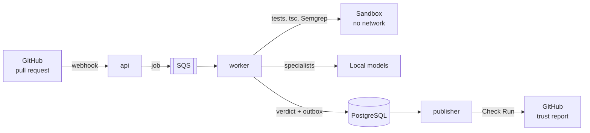

# Scryguard

[](https://github.com/RahulNayak6467/Scryguard/actions/workflows/ci.yml)

A trust gate for pull requests written by AI coding agents.

Coding agents now open a lot of pull requests, and they tend to fail in the
same few ways. They delete or weaken tests until the build passes. They
silence the type checker instead of fixing the code. They call functions
that don't exist and install packages nobody has heard of. They describe
changes they didn't make.

Scryguard checks for exactly these problems before a human reviews the
change, and it only reports what it can prove. Every finding comes with
evidence: test results from both commits, the line that suppresses a
check, the missing symbol, the registry record for a new package.

> **Status:** in active development. This README describes the design and
> is updated as each part ships. See the [roadmap](#roadmap).

## What it does

When an agent opens or updates a pull request, Scryguard:

1. runs the tests, the type checker and static analysis on the base and
   head commits, inside an isolated sandbox;
2. runs four specialist checks, each looking for one kind of agent
   failure;
3. keeps only the findings backed by evidence;
4. posts a trust report on the pull request: pass, needs review or block,
   with every finding linked to its proof.

| Check | Catches |
|---|---|
| Test integrity | Deleted, skipped or weakened tests; snapshots updated without a code change; mocks of the code under test |
| Guardrail bypass | `@ts-ignore`, `eslint-disable`, `any` casts, empty `catch` blocks, removed CI steps, lowered coverage thresholds |
| Hallucinated APIs and dependencies | Calls to functions or types that don't exist; packages that don't exist or were published very recently |
| Intent and completeness | A description the diff doesn't support; unrelated edits; changed functions whose callers weren't updated |

## How it works



A webhook creates a review run, a worker picks it up from the queue, the
agent graph runs the checks, and the verdict is published back to GitHub
as a Check Run. The full design, including failure handling and security
boundaries, is in [docs/architecture.md](docs/architecture.md).

## The interesting parts

**One correct verdict, even when things break.** Jobs are delivered at
least once, workers can crash at any point, and authors push new commits
mid-review. Runs are claimed with an attempt number that fences out stale
workers, the head commit is checked before and after the review, and
verdicts reach GitHub through a transactional outbox, so a result is
never lost, duplicated or out of date.
([ADR 0002](docs/adr/0002-sqs-for-review-jobs.md))

**Untrusted code stays contained.** Repository code runs only in a
sandbox with no network, no credentials and no permissions: a Docker
container locally, an ECS Fargate task in a private subnet with no NAT
gateway on AWS. ([ADR 0005](docs/adr/0005-fargate-sandbox-with-vpc-endpoints.md))

**Evidence over opinion.** A rule-based router picks the specialists, each
specialist is tied to a deterministic evidence source, and an adjudicator
drops anything it can't verify. A check that can't run makes the result
inconclusive, never a pass.
([ADR 0003](docs/adr/0003-langgraph-js-for-agent-orchestration.md),
[ADR 0007](docs/adr/0007-evidence-required-findings.md))

**Measured, not claimed.** The specialists are evaluated on seeded agent
failures and real agent-authored pull requests: detection rate and
precision per failure type, compared with a single-prompt reviewer,
repeated to show variance, with each specialist removed in turn to show
what it contributes.

**Runs on local models.** Chat and embedding models are served by Ollama
on a local GPU, so reviews and evaluation cost nothing per token. One
capped run on a hosted model measures the quality gap.
([ADR 0008](docs/adr/0008-local-models-by-default.md))

## Tech stack

TypeScript on Node.js · Express · PostgreSQL with pgvector · Redis ·
Amazon SQS · LangGraph.js · Ollama · tree-sitter · Semgrep · Docker and
ECS Fargate · Terraform · GitHub Actions.
Details and reasoning: [docs/tech-stack.md](docs/tech-stack.md).

## Getting started

Requires Node.js 24 (24.22.2 or later), pnpm 12.16.1 and Docker.

Run the API against a local PostgreSQL and Redis:

```sh
pnpm install
cp .env.example .env
docker compose up -d --wait
pnpm db:migrate
pnpm dev
```

The API listens on port 8000. `GET /health/live` reports that the process
is up; `GET /health/ready` reports whether it can reach the database.

Run the checks that CI runs. The integration tests use a separate stack:

```sh
cp .env.test.example .env.test
pnpm test:stack
pnpm validate
```

## Roadmap

- [x] Foundation: workspace, CI, local stack
- [ ] GitHub App and first Check Run
- [ ] Data model, GitHub sign-in, API keys, roles and rate limits
- [ ] Crash-safe review processing (SQS, fencing, outbox)
- [ ] Sandbox with base and head execution
- [ ] Agents v1: test integrity and guardrail bypass
- [ ] Code intelligence: symbol table, full-text and vector search
- [ ] Agents v2: hallucinated dependencies, intent and completeness
- [ ] Evaluation suite and results
- [ ] Dashboard with live review timeline
- [ ] AWS deployment with Terraform
- [ ] Hardening: SLOs, load and failure drills, restore drill, public demo repository

## Documentation

- [Architecture](docs/architecture.md): components, review flow, failure
  handling, security boundaries, deployment
- [Tech stack](docs/tech-stack.md): what is used and why
- [Decision records](docs/adr/): the main design choices and the
  alternatives considered
