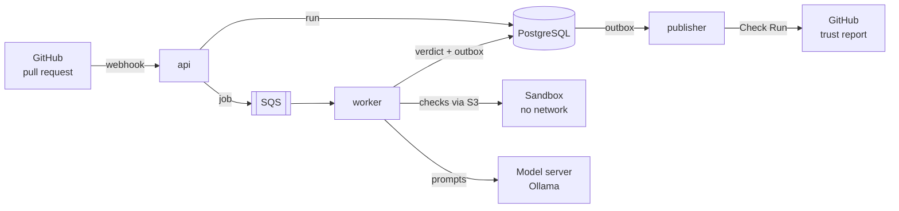
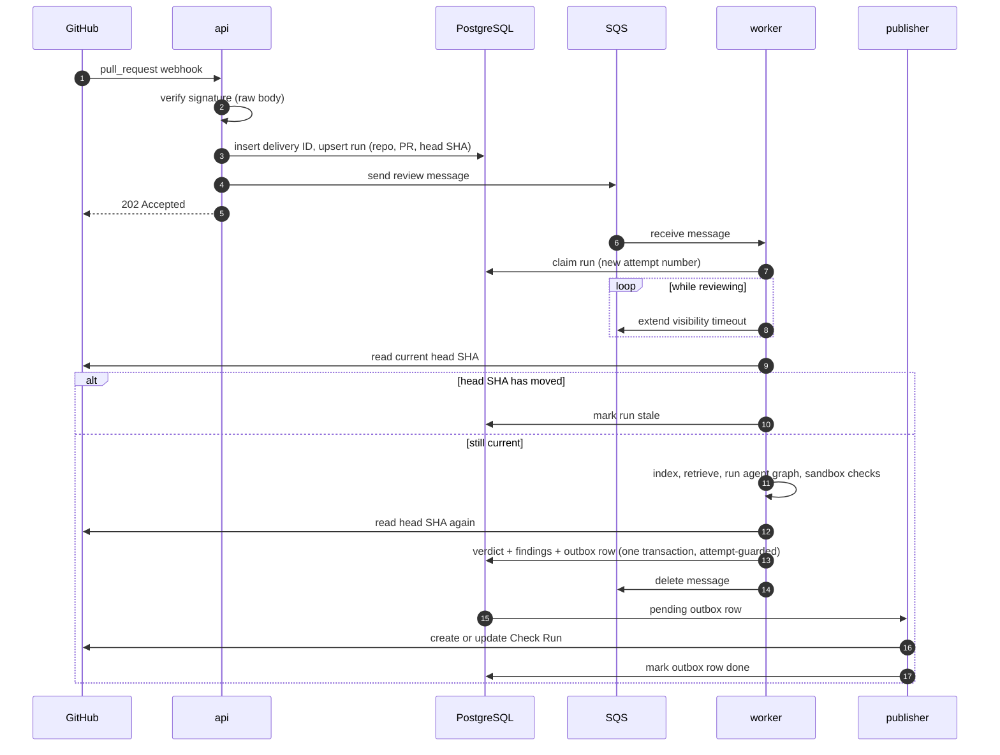
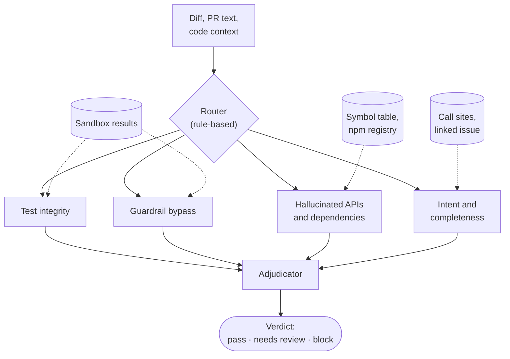
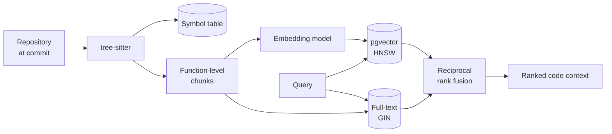
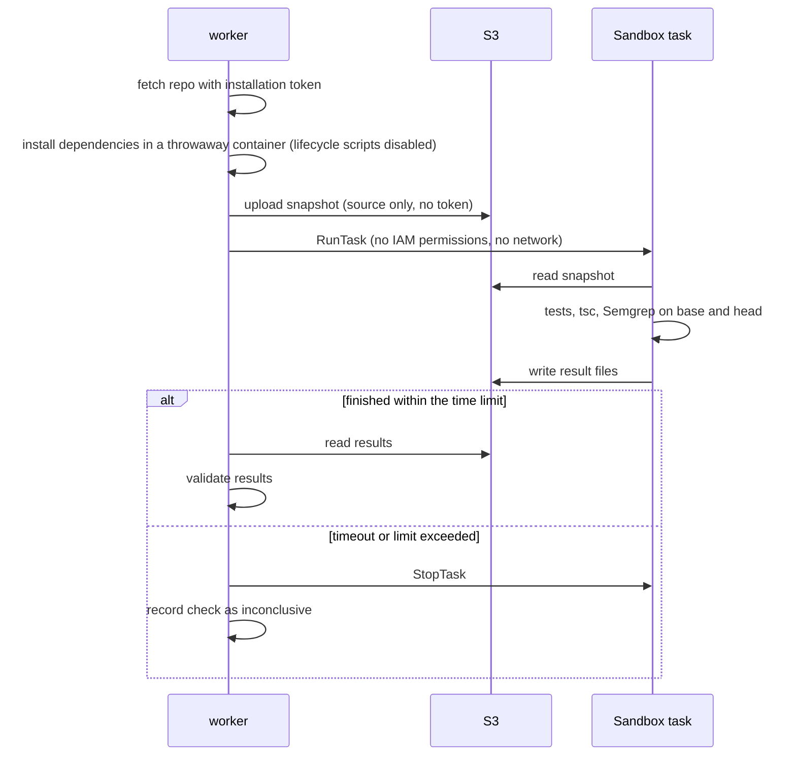
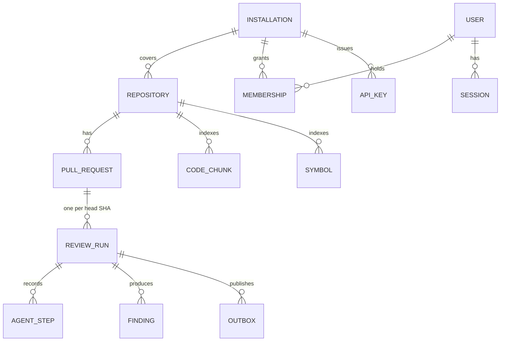
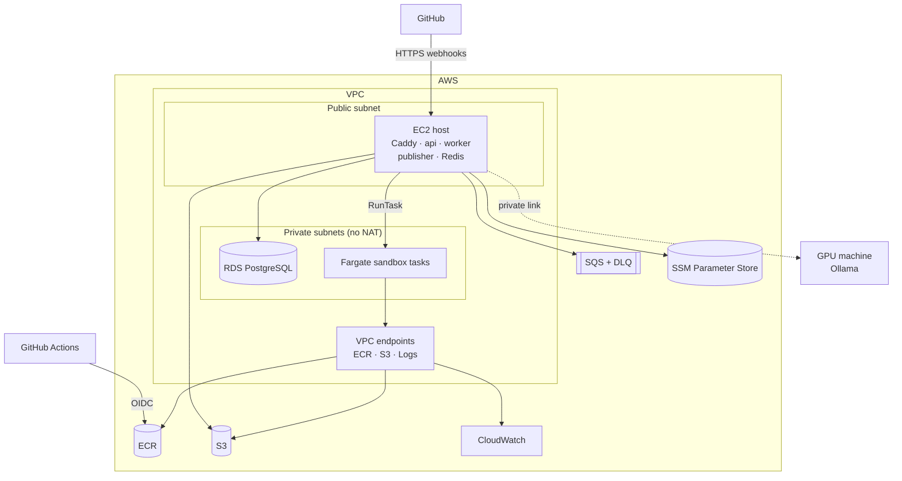

# Architecture

How Scryguard is put together and how it behaves when things go wrong.
This page describes the target design; it is revised as each part is
built. The reasoning behind larger choices is in [docs/adr](adr/).

## Overview

Scryguard is a GitHub App. When an AI coding agent opens or updates a pull
request, Scryguard reviews the head commit and publishes a trust report as
a Check Run.

Live run events flow from the worker through Redis pub/sub to the `api`,
which streams them to the dashboard over SSE.

## Components

| Component | Responsibility |
|---|---|
| `api` | Verifies and deduplicates webhooks, records review runs, serves the dashboard API and live run events (SSE) |
| `worker` | Consumes review jobs, checks the run is still current, gathers code context, runs the agent graph, launches sandbox checks, writes the verdict |
| `publisher` | Sends pending GitHub writes from the outbox and marks them done |
| `dashboard` | Trust reports, live run timeline, evaluation results |
| Sandbox | Runs repository code: tests, type checks and static analysis on the base and head commits |
| Model server | Serves the chat and embedding models over an OpenAI-compatible API |
| PostgreSQL | Source of truth: runs, agent steps, findings, outbox, code index |
| Redis | Caches, rate limits, pub/sub for live events; holds nothing that cannot be lost |
| SQS | Review jobs, with a dead-letter queue |
| S3 / RustFS | Repository snapshots, sandbox results, archived logs |

All application processes come from one codebase ([ADR 0004](adr/0004-modular-monolith-in-a-monorepo.md)).

## Review flow

1. **Intake.** The webhook signature is verified over the raw body. A
   duplicate delivery ID is acknowledged and ignored. Runs are keyed by
   repository, pull request and head SHA; pull requests not identified as
   agent-authored are skipped.
2. **Claim.** A conditional update records a new attempt number. Every
   later write is checked against it, so a superseded worker cannot write.
3. **Freshness.** The head SHA is checked before the review and again
   before the verdict. A run that is no longer current is marked stale and
   publishes nothing.
4. **Verdict and publish.** The verdict and its outbox row commit
   together. The publisher sends the Check Run and marks the row done.

## Agent graph

| Specialist | Looks for | Evidence |
|---|---|---|
| Test integrity | Deleted, skipped or weakened tests; blind snapshot updates; mocks of the unit under test | Test results on base and head; the test-file diff |
| Guardrail bypass | Suppressed type and lint checks, `any` casts, empty `catch` blocks, removed CI steps, lowered thresholds | Semgrep matches; configuration and CI diffs; `tsc` output |
| Hallucinated APIs and dependencies | Calls to symbols that do not exist; packages that do not exist or are suspiciously new | The repository's symbol table; `tsc` output; npm registry metadata |
| Intent and completeness | A description the diff does not support; unrelated edits; callers not updated | Pull request text and linked issue; call sites of changed functions |

The router selects specialists and their budgets from the kind of change.
The adjudicator drops any finding without evidence, merges duplicates and
sets the verdict. A check that could not run makes the result
inconclusive, never a pass ([ADR 0007](adr/0007-evidence-required-findings.md)).
Every node records its input summary, prompt version, tokens, duration and
outcome; the dashboard timeline is built from these records.

## Code index

Chunks are stored per installation, repository and commit. On push, only
changed files are re-indexed. Every query filters by installation and
repository inside the SQL ([ADR 0001](adr/0001-postgresql-as-source-of-truth.md)).

## Sandbox

The sandbox runs as a non-root user with a read-only root filesystem and
limits on CPU, memory, processes, run time and output. On AWS it runs in a
private subnet with no NAT gateway; VPC endpoints for ECR, S3 and
CloudWatch Logs are its only routes
([ADR 0005](adr/0005-fargate-sandbox-with-vpc-endpoints.md)).

## Data model

| Table | Holds |
|---|---|
| `installations`, `repositories` | GitHub App installations and the repositories they cover |
| `users`, `memberships`, `sessions` | Dashboard users, roles per installation, server-side sessions |
| `api_keys` | Installation-scoped keys: prefix, hash, creation and revocation times |
| `webhook_deliveries` | Delivery IDs for deduplication |
| `pull_requests` | Pull request, current head SHA, author classification |
| `review_runs` | One per repository, pull request and head SHA: state, attempt number, cost, timings |
| `agent_steps` | One per graph node per run |
| `findings` | Type, severity, evidence reference, adjudicator decision |
| `outbox` | Pending GitHub writes |
| `code_chunks`, `symbols` | The code index |

## Failure handling

| Failure | Behaviour |
|---|---|
| Webhook delivered twice | Second delivery is acknowledged; the delivery ID already exists |
| Same SQS message received by two workers | Only one conditional claim succeeds; the other worker stops |
| Worker crashes mid-review | Heartbeats stop, the message becomes visible again, a new attempt starts; writes from the old attempt are rejected |
| New commit pushed mid-review | The freshness check marks the old run stale; it publishes nothing |
| Crash after the verdict is written | The outbox row remains; the publisher sends it on restart |
| GitHub returns errors to the publisher | Retries with backoff; the Check Run is created once and then updated |
| A message fails repeatedly | Moved to the DLQ after a fixed number of receives; the run is marked failed; an alarm fires |
| Model server slow or down | Calls time out; the run is inconclusive, never a pass |
| Sandbox times out or exceeds limits | The task is stopped; the check is inconclusive |
| Redis unavailable | Caches are skipped and reviews continue; rate limiting follows its documented fail mode |
| Malicious repository code | Contained by the sandbox; it has no network, no credentials and no permissions |

## Security boundaries

| Zone | Trust | Rules |
|---|---|---|
| GitHub webhooks | Untrusted until verified | Signature checked over the raw body before parsing |
| Repository code, diffs, PR text, logs | Untrusted | Executed only in the sandbox; passed to models as delimited data that cannot select tools, paths or network targets |
| Model output | Untrusted | Validated against a schema; never executed |
| Dashboard requests | Authenticated | GitHub OAuth, server-side sessions, roles per installation; every query scoped to the installation |
| API requests | Authenticated | Installation-scoped API keys stored as hashes, compared in constant time, revocable; rate-limited per key |
| Secrets | Restricted | Stored in SSM Parameter Store; never logged; never passed to the sandbox |

## Deployment

| | Local | AWS |
|---|---|---|
| Processes | Docker Compose | Containers on one EC2 host behind Caddy |
| Database | PostgreSQL with pgvector | RDS PostgreSQL |
| Queue | ElasticMQ | SQS with DLQ |
| Object storage | RustFS | S3 |
| Sandbox | Docker | ECS Fargate |
| Models | Ollama on the GPU machine | Same, over a private connection |
| Secrets | `.env` | SSM Parameter Store |

Infrastructure is defined in Terraform, and CI deploys through GitHub OIDC
([ADR 0006](adr/0006-lean-aws-footprint.md)).

## Observability

Structured JSON logs carry a request ID and a run ID on every line.
Metrics cover webhook intake, queue depth and age, review duration and
outcome, sandbox failures, model latency and token use, with Grafana
dashboards kept in the repository. Two SLOs, webhook acknowledgement latency
and review completion time, are tracked with burn-rate alarms. CloudWatch
alarms also watch DLQ depth, oldest message age, sandbox failures and the API
error rate, and each alarm links to a runbook.
